# EVE Mining Monitor

**Track your EVE Online mining fleet in one window.** EVE Mining Monitor reads local Gamelogs to estimate what each ship has mined, how much cargo space is left, and when the fleet might need to unload. It also estimates reprocessing value, keeps a fleet-wide mining history, and can warn you about cargo, rocks, or ships that need attention.

**V2.18.13** · Windows and macOS · English and German Gamelogs

| Platform | Download | Start |
| --- | --- | --- |
| Windows | [V2.18.13 Windows ZIP](https://github.com/Marci1125/Eve-Mining-Monitor/releases/download/v2.18.13/EVE-Mining-V2.18.13-Python-Share.zip) | Extract the ZIP and run **EVE-Mining.exe**. Python is bundled. |
| macOS | [V2.18.13 macOS ZIP](https://github.com/Marci1125/Eve-Mining-Monitor/releases/download/v2.18.13/EVE-Mining-V2.18.13-macOS.zip) | Install Python 3.12 with Tk, extract the ZIP and open **Start EVE Mining.command**. The launcher installs the audio dependency on first launch. |

[Release history](https://github.com/Marci1125/Eve-Mining-Monitor/releases) · [Python for macOS](https://www.python.org/downloads/macos/)

**User guide** · [First launch](#first-launch) · [Fleet profiles](#fleet-profiles) · [Fleet overview](#fleet-overview) · [Sessions](#sessions) · [Reprocess](#reprocess) · [Ledger](#ledger) · [Track Rock](#track-rock) · [Belt Estimate](#belt-estimate) · [Prices](#prices--janice) · [Alerts](#alerts) · [Display](#display-style) · [Languages](#languages) · [Update notifications](#update-notifications) · [Updating](#updating-and-sharing)

## What changed from V2.18.10 to V2.18.13

- Added saved belt reference scans and remaining percentages overall and by material.
- Added completion-time comparisons for Porpoise, Orca and Rorqual boosts.
- Added optional GitHub release checks at startup, enabled by default, and a manual **Check now** button.
- Added **Options → Updates**, a release notification and a clickable update link in the main window.
- Extended the English and German tutorial to introduce the update settings.

## First launch

Extract the full ZIP into a writable folder. On your first launch without a profile, the tutorial highlights **Options**, guides you through selecting your Gamelogs folder and adding pilots, then introduces the main controls and settings. Use **Back** to revisit a step or **Skip tutorial** to set up on your own. The Reprocess example uses sample data.

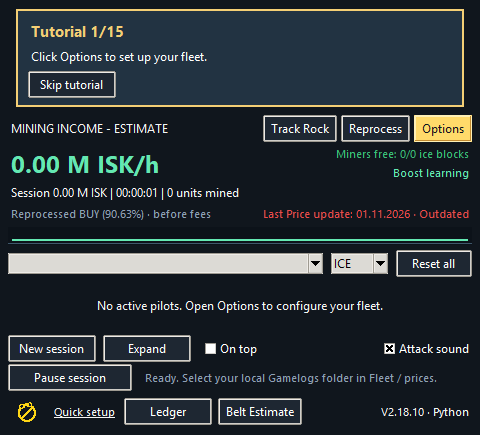

## Fleet profiles

1. Open **Options → Fleet profiles** and click **Log folder…**. Select the **Gamelogs** folder that contains EVE’s session `.txt` files. The selected path appears in the white field. On Windows, a common location is `C:\Users\<your name>\Documents\EVE\logs\Gamelogs`. Your folder may be inside OneDrive or use a localized Documents folder.
2. Click **Add pilots from logs**. If the list stays empty, check the selected folder and open EVE to generate a Gamelog.
3. Choose a ship class and enter its actual in-game hold capacity, active laser count, and raw unboosted cycle time. A cycle time of **0** enables automatic learning. Set lasers to **0** for a boost-only pilot.
4. Choose **ICE** or **ORE**, name the profile, and click **Save and activate profile**.

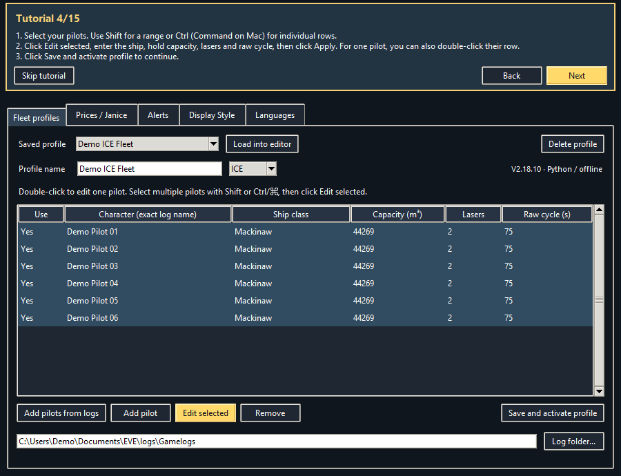

### Edit several pilots together

Use **Shift** to select a range or **Ctrl** (**Command** on macOS) to select individual rows. Click **Edit selected**, set the shared ship class, capacity, lasers or cycle time, and click **Apply**. A blank field keeps its existing value for each pilot. Click **Save and activate profile** to save the changes. Double-click a row to edit one pilot.

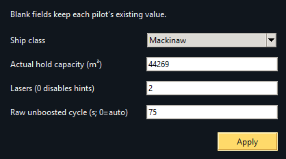

## Fleet overview

Choose your fleet profile and **ICE** or **ORE** from the main window. Each pilot shows cargo, free space, an estimated time to fill, recent yield and status. **Miners free** shows remaining mining capacity across the fleet and excludes boost-only ships. **Expand** adds cycle details, and **On top** keeps the monitor above other windows.

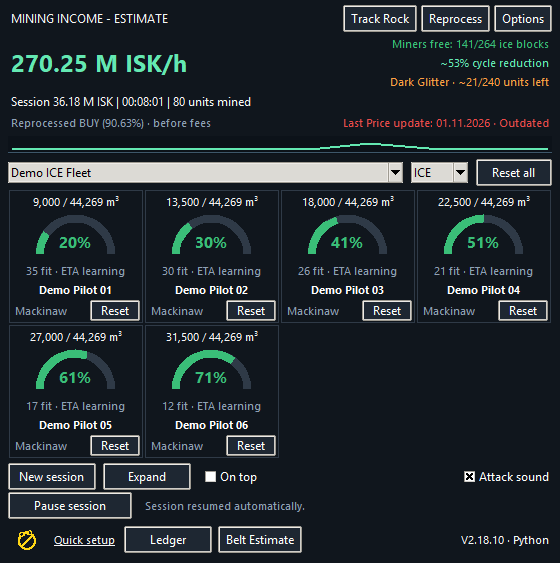

- **Cargo.** The monitor converts mined units to hold volume. Logged compression adjusts the occupied volume. In ICE mode the hold counts as full when it cannot fit another whole block.
- **Colors.** Green shows normal cargo. Yellow flags a critical yield for 30 seconds. Orange marks the configured cargo alert threshold. Red warns at 95% or when another ice block will not fit. A short highlight marks a new cargo alert.
- **Recent yield.** A **+quantity** appears for five seconds after a mining result is read. It includes critical bonus units.
- **Boost and ETA.** These are estimates from observed log intervals. Small yields of 50 m³ or less still count toward cargo and income. The cycle detector skips them so drone yields are less likely to distort the estimate.
- **Manual cargo.** Use a pilot’s **Reset** after emptying that hold or **Reset all** after unloading the whole fleet. Right-click a pilot to enter or confirm the actual cargo. On macOS, use secondary click or Control-click. Jettison and transfers require a manual correction.
- **Optional auto-reset.** Enable it in **Fleet profiles** if you fully unload after a fleet warp. It looks for a mining yield, fleet warp and a matching hangar notification. It allows final mining ticks within ten seconds of the warp.

## Sessions

Use **Pause session** and **Resume session** to control active session time. The monitor also pauses after five minutes without mining and resumes on the next yield. **New session** archives the previous mining totals in **Session Logs**, clears the current mining totals and timer, and keeps the cargo counters.

The overview includes total mined units, estimated ISK/h, a short rate trend, and the last price update. ISK/h uses the BUY value of reprocessed products at 90.63% yield before fees. It refreshes once a minute and when session or pause state changes. For the underlying quantities and products, open **Reprocess** or **Ledger** from the same overview shown above.

## Reprocess

Open **Reprocess** to see the materials mined this session and their estimated reprocessing outputs, including cargo already unloaded. Set your yield and click **Calculate / refresh**. The estimate uses complete batches and whole output units and lists leftovers and unsupported materials.

Quantities, volume, and available BUY or SELL values appear in the tables. Imported BUY prices take priority over bundled sample prices. The mined-material table uses compressed equivalents for price comparison.

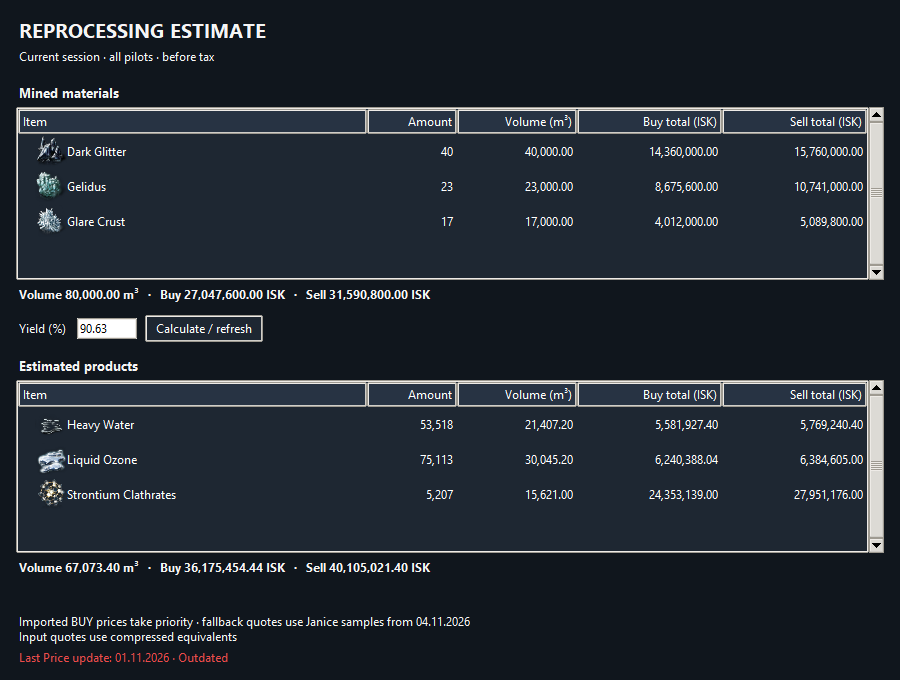

## Ledger

Open **Ledger** to see mining totals for **all tracked pilots together**. The default date range runs from seven days ago to today in UTC. You can edit **From (UTC)** and **To (UTC)**, or click **Current session** to show the active session across all pilots, including a session that spans midnight. Click it again to return to the date range.

Use **All materials**, **Ice materials**, **Ore materials**, or an individual material to filter both charts, the table and the totals. Moon ore is included in **Ore materials**.

The horizontal chart shows every material in the selection, sorted by quantity, with its icon and a consistent color. The chart grows with the list. For a list longer than the available screen height, scroll within the chart to reach the remaining materials.

**Critical bonus units are included in the total bar length.** Their share is highlighted at the right end in yellow for ice and turquoise for ore. The daily chart uses the same colors and bonus highlights. Hover over a chart to see quantities and critical bonus units.

The table includes quantity, volume, **Crits**, **Bonus units** and **% extra**. **% extra** is the critical bonus divided by the regular quantity mined for that date and material. Critical counters start with logs read by V2.18.2 or later. Older saved totals can still appear without critical statistics.

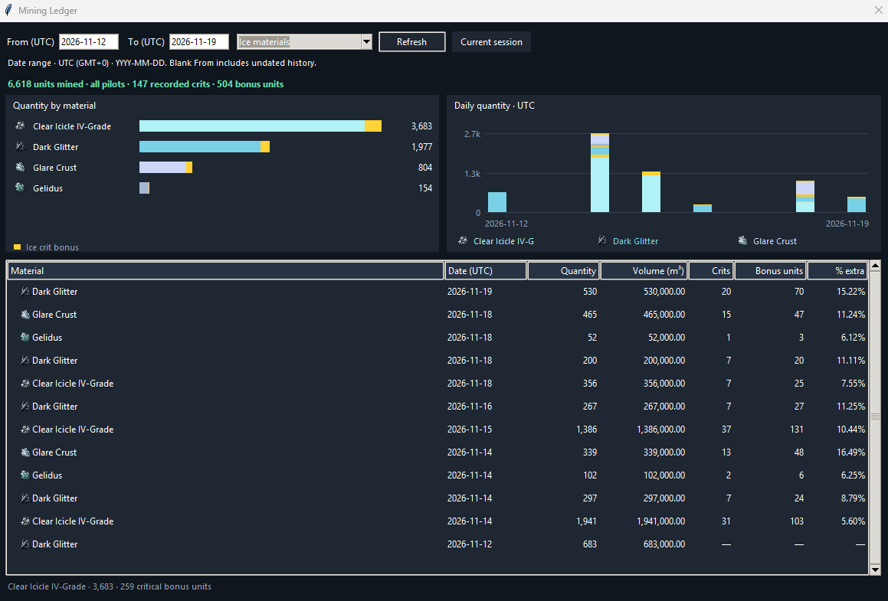

## Track Rock

Scan one target in EVE, click **Track Rock**, and enter the remaining number of units. The first regular yield in the chosen mode identifies the material. Matching yields and logged residue reduce the estimate. Critical bonus units add to your hold without depleting the rock.

The remaining amount appears below the boost estimate. Use **Options → Alerts** to set the low-quantity warning threshold and a separate sound for depletion. The estimate works best when all matching yields come from one rock and the Gamelogs cover everyone mining it.

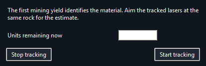

## Belt Estimate

Open **Belt Estimate** beside **Ledger** and paste a complete ice or ore survey scan.

### Reference scans and remaining percentage

Click **Compare scan** to compare the pasted survey with the saved reference. The result shows the total remaining amount and a breakdown by material. The comparison can be used independently of the mining-time calculation.

Use **Use scan as 100%** to save a reference for the current ICE or ORE mode. Paste a newer complete scan from the same belt to measure its remaining percentage. References are saved locally. An observed ICE reference is included with the tool.

The percentage is relative to the saved scan. Its initial spawn quantity is unverified. Choose a fresh, complete scan from your own belt for the closest comparison. The tool flags materials missing from the reference and quantities above the reference.

### Mining time and boost comparison

Choose a fleet profile matching the scan, enter the expected minutes your fleet pauses for each unload, and click **Calculate**. The result includes mining time, expected cargo with critical bonuses, unloading stops and total time.

The log-based estimate uses qualifying historical runs from the selected Gamelogs folder, which can include different boosts. ICE uses complete cargo fills. ORE measures continuous mining samples by volume in m³. At least three qualifying samples are needed.

The additional boost comparison normalizes stable laser samples using the raw cycle times in your fleet profile. Enter the raw unboosted cycle for every miner and use logs from a matching ship setup. Each row shows mining time and total time including unloads.

| Reference boost | Assumed setup | Cycle reduction |
| --- | --- | --- |
| Porpoise | Max skills, Burst II, mindlink, core off | 38.67% |
| Orca | Max skills, Burst II, mindlink, T2 core active | 46.49% |
| Rorqual | Max skills, Burst II, mindlink, T2 core active | 61.52% |

Critical bonus units affect cargo and unloading estimates. Detected small drone yields retain their observed rate. If the raw cycles or stable samples are missing, the tool shows a message for the boost comparison.

## Prices / Janice

In **Options → Prices / Janice**, click **Export price item list** to create `Reprocessing-products.txt` beside the app. Appraise that list in Janice, copy the Item / Amount / Volume / Buy / Sell rows, then use **Paste price set…** to import the BUY prices. You can also double-click a material to set its BUY price manually.

The export includes all 43 reprocessing products, including isotopes and moon ore products. Missing quotes can leave estimates partial. **Last Price update** turns red after seven days.

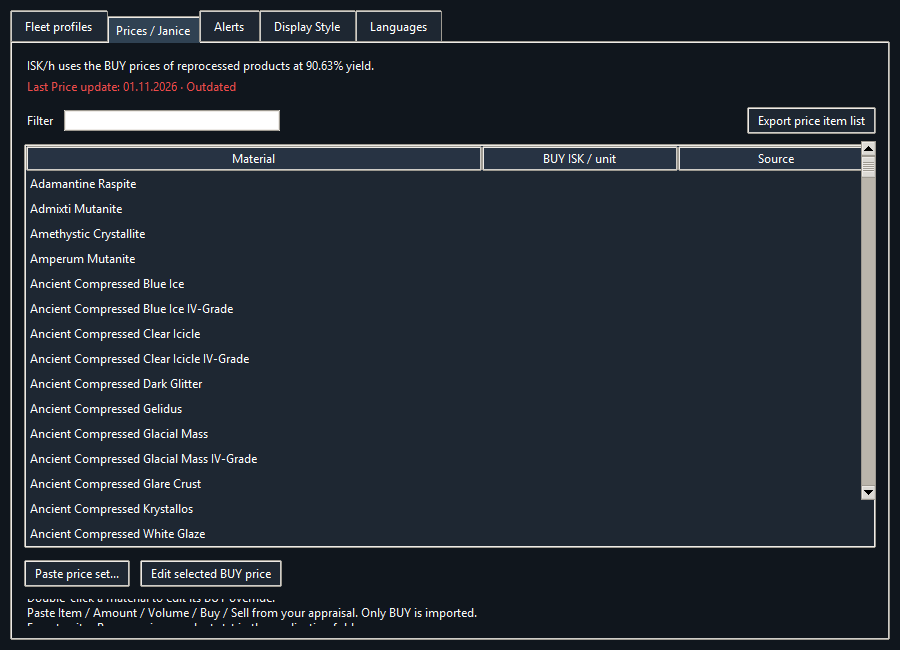

## Alerts

Open **Options → Alerts** to enable, choose, test and set the volume for each sound. The available alerts cover cargo threshold, incoming attack, persistent irregular mining, low rock quantity and rock depletion. The ship attention sound waits for four consecutive estimated cycles of irregular activity.

Click **Save alert settings** to apply changes. For custom audio, add an MP3 or WAV to **Sounds**, then click **Refresh sounds**. Set the cargo threshold in **Fleet profiles** and the rock threshold in **Alerts**.

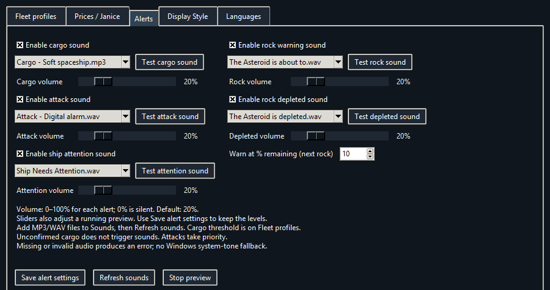

## Display Style

Use **Options → Display Style** to select **Bars**, **Gauges**, or **Fleet Strip**, then click **Apply display style**. Gauges display compressed cargo as a dashed grey segment. Fleet Strip fits more pilots into compact tiles. Hover over a tile for details.

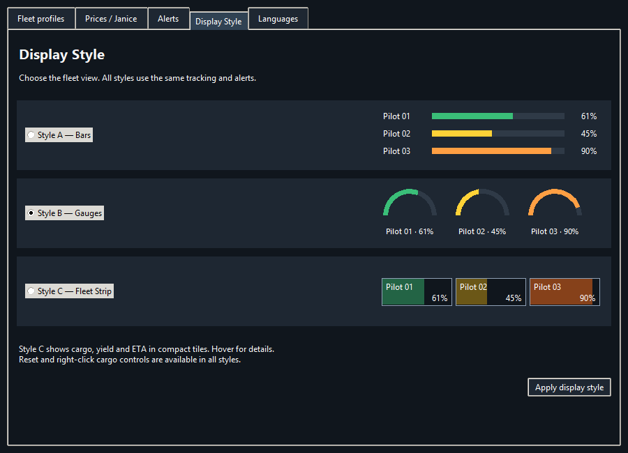

See Bars and Fleet Strip in the main window

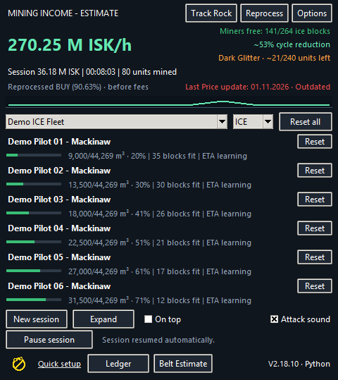

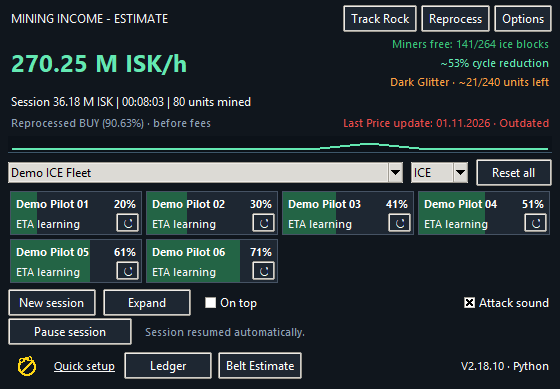

## Languages

Use **Options → Languages** to set English or German and restart the monitor to apply the interface language. The monitor automatically recognizes English and German Gamelogs. **Restart Tutorial** replays the guided setup at any time.

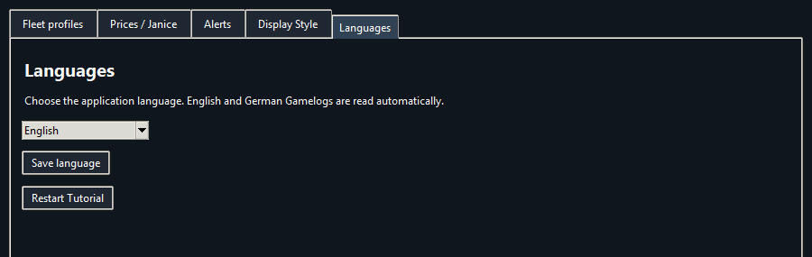

## Update notifications

The monitor checks this repository's latest published release at startup and compares its version with the installed version. Startup checks are **enabled by default**.

When a newer release is available, a small notification offers **View update**, which opens the GitHub release page with the changelog and Windows and macOS downloads. The version label in the main window also becomes a clickable update link.

Under **Options → Updates**, turn **Check for updates on startup** on or off, or click **Check now** to run a manual check. The choice is saved locally. The check runs in the background. Connection failures appear in the update settings.

Checks use GitHub's public Releases API and need an internet connection. Users of an earlier version must install V2.18.13 or later once to receive these notifications.

## Updating and sharing

Close the old version, extract the new ZIP into a writable folder, and copy **EVE-Mining.python-state.json**, **Session Logs**, and any custom sounds you want to keep into the new folder. Put the state file beside the Windows EXE or macOS launcher. Use the original ZIP when sharing a fresh copy. The ZIP includes **CHECKSUMS.txt** and third-party notices.

The monitor reads local Gamelogs and uses bundled or manually imported prices. Optional release checks request public GitHub release information. View update opens the release page in your browser. The Windows build extracts its bundled Python runtime into the temporary directory at launch. Reprocessing data and additional item icons come from CCP’s static data and EVE Image Server.

The Belt Estimate and update notification images show V2.18.13. Other screenshots illustrate the corresponding V2.18.10 views. The Ledger screenshot shows real mining history.
