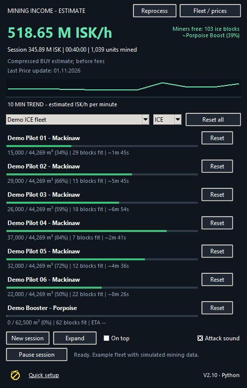
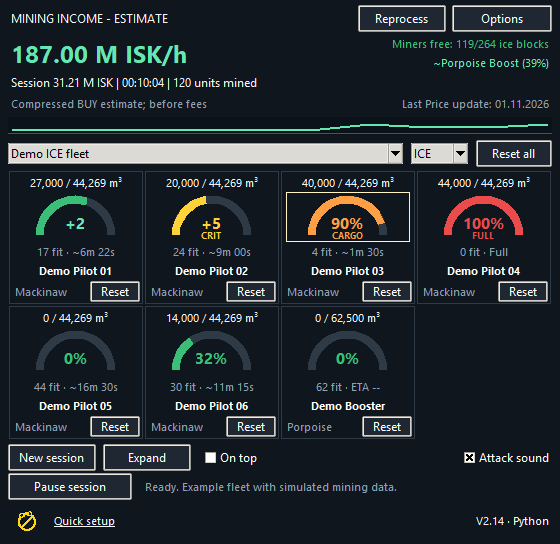
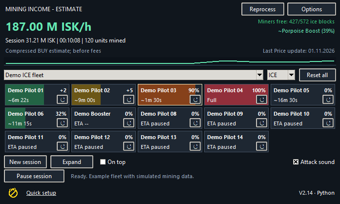
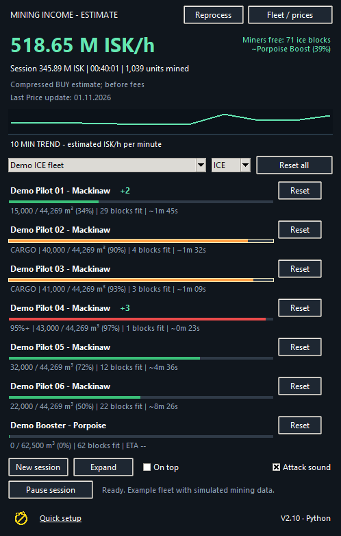
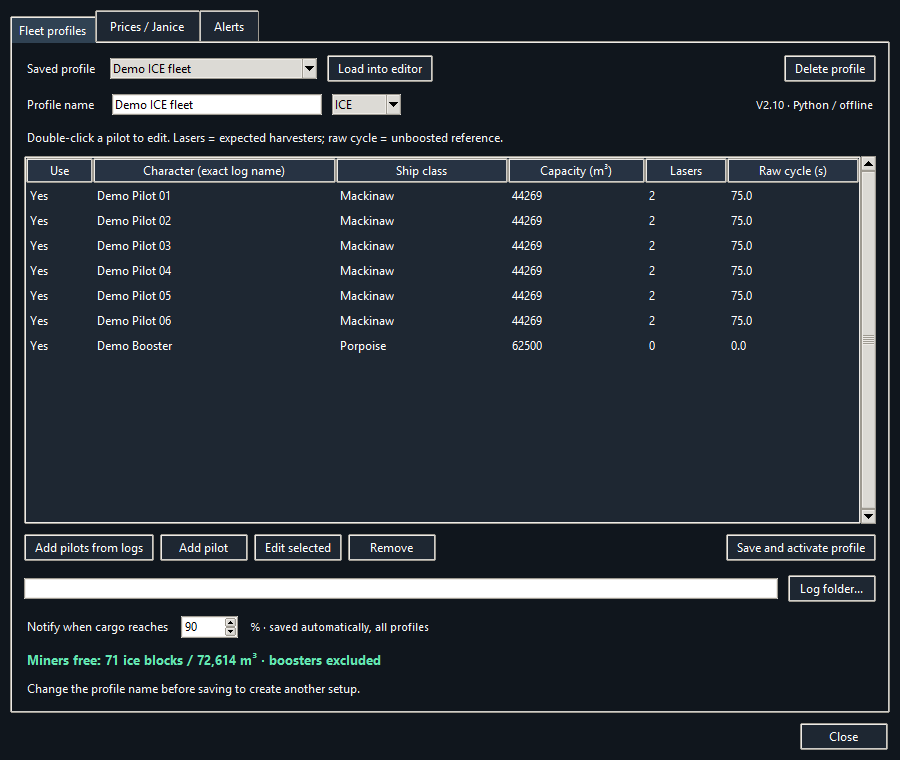
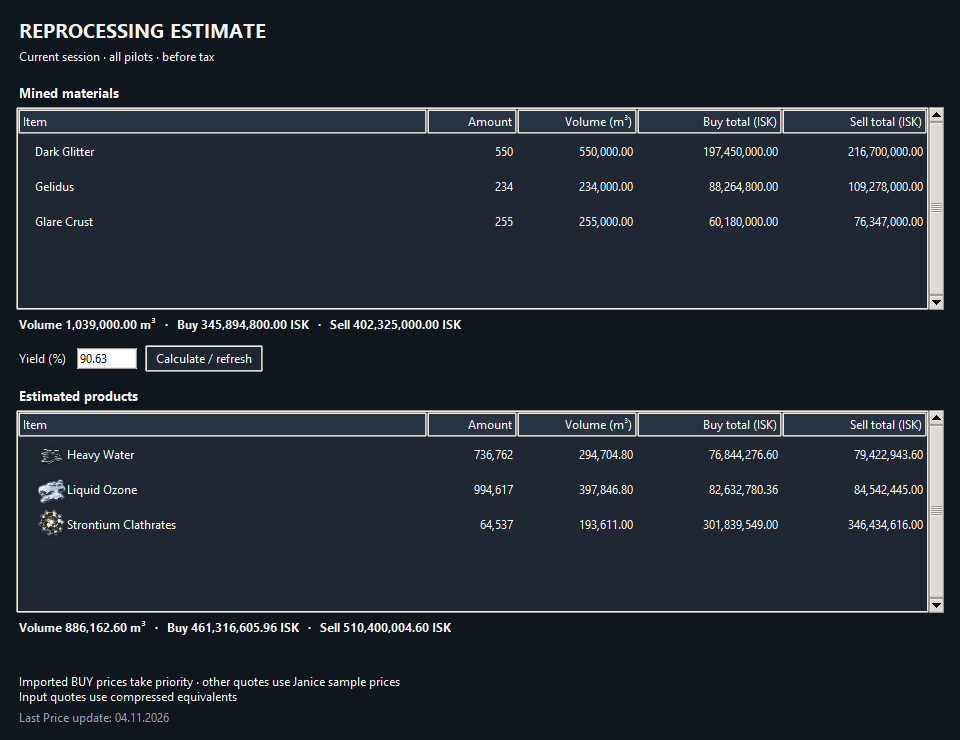
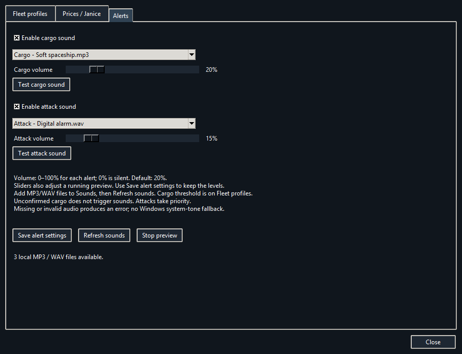

# EVE Mining

**V2.14 — Python edition**

A compact Windows monitor for multiple EVE Online mining characters. Track holds, estimated income and reprocessing products from English game logs.

## Download

[Download EVE Mining V2.14](https://github.com/Marci1125/Eve-Mining-Monitor/raw/refs/heads/main/EVE-Mining-V2.14-Python-Share.zip)

Extract the complete ZIP into a writable local folder and run **EVE-Mining.exe**. Keep **Sounds**, **Licenses** and the included documentation together. Python is bundled; no Python installation or administrator rights are required.

The share package starts without personal profiles, session data or a configured log path. It includes the dated default BUY-price snapshot. Prices are not live.

## What changed from V2.10 to V2.14

- **V2.11 — Compact layout.** Shorter header and pilot rows. Larger fleets use multiple columns so pilots stay visible without scrolling. **Expand** shows cycle details.
- **V2.12 and V2.12.1 — Optional cargo auto-reset.** A mining yield, fleet warp and matching hangar notification can reset a pilot's hold once. Final yields during the first ten seconds after the warp notification are accepted. Later mining requires a new warp. Enable the option in **Options > Fleet profiles** if you unload the entire hold.
- **V2.13 — Two display styles and clearer cargo status.** **Style A — Bars** and **Style B — Gauges** are selectable under **Options > Display Style**. ICE holds show **100%** when another whole block cannot fit. **Miners free** shows remaining and total capacity with warning colors. Boost estimates keep the previous ship label while observed cycle times still match it.
- **V2.13.1 and V2.13.2 — Layout fixes and smaller gauges.** Fixed the initial window width and missing pilot rows when switching from gauges to bars. Compact gauge cards are smaller and center the percentage or recent yield inside the gauge.
- **V2.14 — Style C, Fleet Strip.** Shallow colored cargo tiles show fill, ETA, recent yields and Reset. Hover for detailed cargo and cycle information. The app remembers the selected style. The example below shows 14 pilots at once.

## Reprocessing and prices

- **Reprocess** estimates products from the current session using 462 bundled recipes, complete batches and an adjustable yield. The default is **90.63%**. Product icons for all 43 possible outputs are bundled for offline use.
- Input and output tables show quantity, volume and available BUY/SELL valuations. Imported BUY prices take priority over the dated example quotes. Missing prices stay unpriced and partial totals are marked.
- **Last Price update** shows the recorded price date and turns red after seven days.
- A green **+quantity** appears beside a pilot for five seconds after a mining yield is read. Simultaneous laser yields and critical bonus quantities add together. Delayed log writes are supported.
- The price export now includes **Helium Isotopes, Hydrogen Isotopes, Nitrogen Isotopes and Oxygen Isotopes**, each with quantity **1**.

## Screenshots

All screenshots use fictional pilots and simulated mining data. Example prices are dated snapshots.

### Style A — Bars

Each pilot has a hold bar, remaining capacity, estimated time to full and an individual reset. The header shows total free space for miners and a boost estimate based on observed log intervals.

### Style B — Gauges

### Style C — Fleet Strip

### Cargo alerts and recent mining yields

Orange identifies a pilot above the configured cargo-alert threshold. A bright frame marks a newly triggered alert for five seconds. Red warns at 95% capacity or when another ice block will not fit. The green **+2** / **+3** beside a pilot shows newly read mining quantities for five seconds.

### Fleet profiles

Save different ship setups with each character's actual hold capacity, expected harvester count and raw unboosted cycle time. Set lasers to **0** for a boost-only ship. The cargo notification threshold is configured here. Fleet free capacity excludes booster ships.

### Reprocessing estimate

Click **Reprocess** to estimate the products from materials mined during the current session, across all pilots. Change the yield and click **Calculate / refresh**. Complete batches, whole product units, leftovers and unsupported materials are accounted for. Results are before tax and do not perform any action in EVE.

### Sound settings

Choose separate cargo and attack sounds, adjust each volume and save. Add your own MP3/WAV files to **Sounds**, then click **Refresh sounds**. The bundled attack clips are four seconds long.

## Quick setup

1. Open **Options > Fleet profiles** and select your local EVE **Gamelogs** folder.
2. Click **Add pilots from logs**, then double-click each pilot to edit.
3. Set ship class, actual in-game hold capacity, expected lasers and raw unboosted cycle. A cycle of **0** enables automatic learning.
4. Name your profile, choose **ICE / ORE**, then **Save and activate profile**.
5. Confirm starting cargo with **Reset** if empty, or right-click the pilot to set/confirm it.
6. Under **Alerts**, choose and test local cargo/attack sounds, then save.
7. Under **Prices / Janice**, use **Export price item list**. Paste the generated **Compressed-items.txt** into your appraisal tool, copy its Item / Amount / Volume / Buy / Sell rows and use **Paste price set...**. BUY prices are imported.

English EVE mining/combat log notifications are required. Update prices manually when needed. No market connection is made by the monitor.

## Other features and behavior

- ICE and ORE cargo tracking with material-specific volumes and logged compression.
- Estimated income values raw mined units using matching compressed-item **BUY** quotes at 1:1. Compressing cargo does not count income twice.
- Critical yields highlight the hold indicator for 30 seconds.
- Mining activity hints account for observed boosts and unequal laser cycles. Boost identification and ETA are estimates based on past log entries, with a delay when conditions change.
- Incoming-attack and cargo-threshold sound notifications have independent volume settings.
- Automatic session pause after five minutes without mining; the next mining yield resumes.
- Headline ISK/h updates every 60 seconds, or on session/pause changes.

Reset cargo after unloading or correct the remaining volume manually when needed. Automatic reset assumes the entire hold was unloaded after the matching hangar notification. **New session** clears income/time while retaining cargo counters. Reprocessing uses session totals, including mined material already unloaded.

## Updating and personal data

Close the old version before updating. Keep **EVE-Mining.python-state.json** from your current folder and copy it beside the new EXE before first launch. This preserves profiles, prices, cargo, sound preferences and the session. V2.14 also remembers the selected display style. Keep the current Sounds folder if you added custom files.

Do not share either **EVE-Mining.python-state.json** or **EVE-Mining.native-state.json**, their backups/temporary files or **.python-instance.lock**. Use the blank share ZIP instead.

For migration from the C# edition, copy **EVE-Mining.native-state.json** beside the new EXE before first use. It is imported only if no Python state exists; the original is retained.

## Local operation and included data

The application reads the configured local gamelogs and does not control EVE or automate gameplay. It has no application network client, browser launch or automatic updater. Sounds, product icons, material volumes, reprocessing recipes and default prices are bundled.

Python, Tkinter and PyInstaller are used. The one-file bootloader temporarily extracts its runtime at startup. Windows provides normal UI, file and audio services. OneDrive synchronization remains independent.

The ZIP includes **CHECKSUMS.txt**, a usage guide and third-party license notices. Reprocessing data and additional product icons originate from CCP's EVE static data and Image Server. Keep **Licenses** with redistributed copies.

