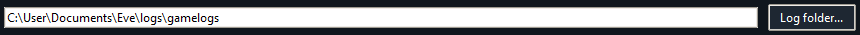
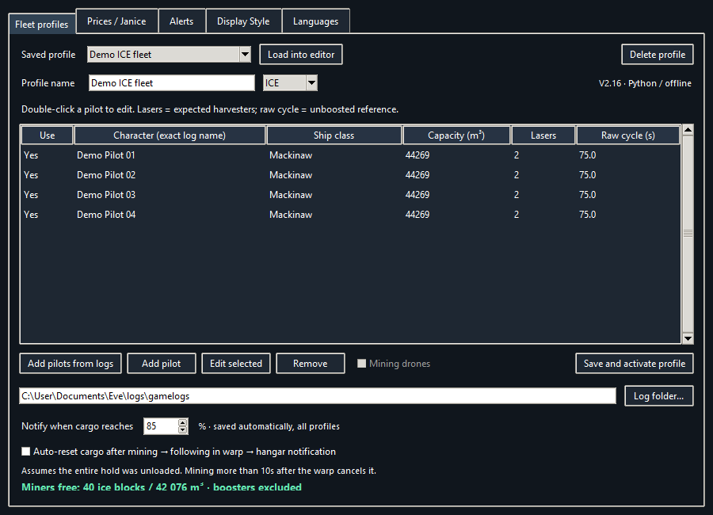
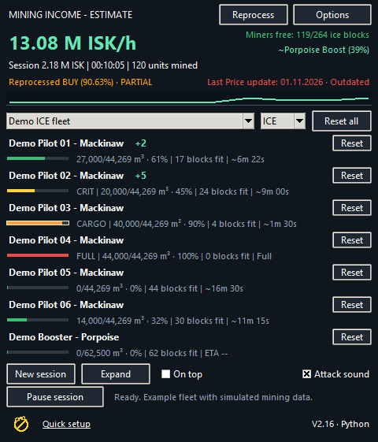
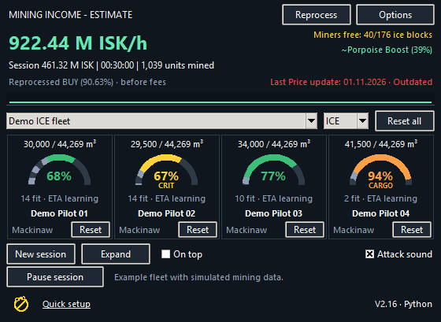
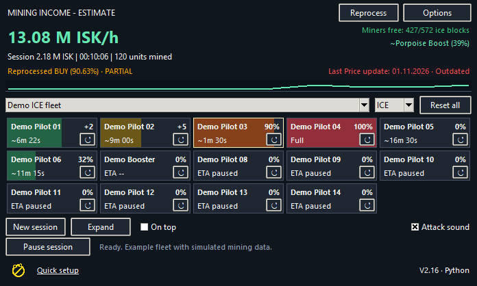
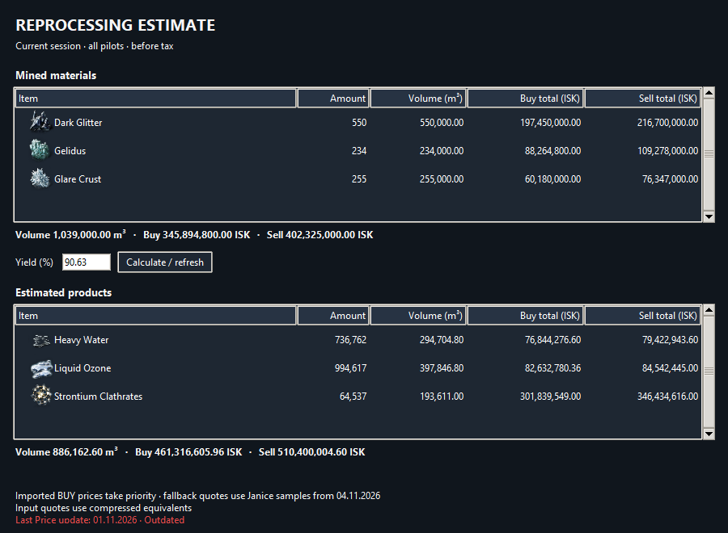

# EVE Mining Monitor

**V2.18 · Windows and macOS**

Track cargo, estimated mining income and reprocessing products across multiple EVE Online pilots. V2.18 reads English and German Gamelogs. Choose the interface language under **Options → Languages** and restart.

| Platform | Download | Start |
| --- | --- | --- |
| Windows | [V2.18 Windows ZIP](https://github.com/Marci1125/Eve-Mining-Monitor/raw/refs/heads/main/EVE-Mining-V2.18-Python-Share.zip) | Extract the ZIP and run **EVE-Mining.exe**. Python is bundled. No Python installation or administrator rights are required. |
| macOS | [V2.18 macOS ZIP](https://github.com/Marci1125/Eve-Mining-Monitor/raw/refs/heads/main/EVE-Mining-V2.18-macOS.zip) | Install [Python 3.12 with Tk](https://www.python.org/downloads/macos/), extract the ZIP and open **Start EVE Mining.command**. The first launch installs the audio dependency into a local environment. |

Extract the complete ZIP into a writable folder and keep the included files together. Both packages start with blank fleet profiles and no configured Gamelogs folder.

## Quick setup

1. **Select your Gamelogs folder first.** Open **Options → Fleet profiles**, click **Log folder...** near the bottom, and choose the **Gamelogs** folder that contains EVE's `.txt` session logs. Once selected, the path appears beside the button. The monitor needs this folder to find pilots and track mining.

   

   The example path is `C:\User\Documents\Eve\logs\gamelogs`. Choose the folder where your EVE client actually writes its logs, which may be under OneDrive or a localized Documents folder.
2. Click **Add pilots from logs**. Select several pilots and click **Edit selected**, or double-click one pilot. Set the ship class, actual in-game hold capacity, number of lasers and raw unboosted cycle time. Enter the capacity shown in EVE for that character, since skills and ship choice can change it. Set lasers to **0** for a boost-only ship. A raw cycle of **0** enables automatic learning.
3. Name your profile, choose **ICE** or **ORE**, and click **Save and activate profile**.
4. Confirm each pilot's starting cargo. Click **Reset** if the hold is empty, or right-click the pilot to enter its current cargo. Test cargo, attack and rock sounds under **Options → Alerts**.

## What changed from V2.16 to V2.18

- Edit ship class, hold capacity, lasers and raw cycle for multiple pilots in one step.
- Mining yields of 50 m³ or less are automatically excluded from laser cycle and boost detection. They still count toward cargo, income and reprocessing.
- **Mining Ledger** combines mining history from all tracked pilots, with material and UTC date filters and a local session archive.
- **Track Rock** estimates the remaining units on a single ice or ore target and plays a dedicated three-second warning at the configured threshold.

## Mining Ledger and Track Rock

Open **Ledger** from the main window to see the current session and archived mining across your fleet. **New session** saves the previous session locally in **Session Logs**.

Open **Track Rock** and enter the remaining unit count from your scan. The first regular yield in the chosen ICE or ORE mode identifies the material. Matching yields and logged residue reduce the estimate. Critical bonus yield counts toward cargo without depleting the target. The estimate assumes all matching yields come from the same rock and everyone mining it is tracked.

## Choose a fleet view

Open **Options → Display Style** to switch between **Style A — Bars**, **Style B — Gauges** and **Style C — Fleet Strip**. All three show cargo, recent yields, estimated time to full and individual resets. **Expand** shows detailed cycle information. The monitor remembers the selected style. Large fleets use multiple columns, and Style C packs pilots into shallow tiles. Hover over a tile for detailed cargo and cycle information.

**Style A — Bars**

**Style B — Gauges**

**Style C — Fleet Strip**

Green indicates normal mining. Yellow marks a critical yield for 30 seconds. Orange marks the configured cargo alert threshold and a bright frame identifies a newly triggered alert for five seconds. Red warns at 95% or when another ice block will not fit. An ICE hold displays **100%** when no whole block fits. ORE uses each material’s volume.

A new yield appears as **+quantity** for five seconds after the monitor reads it, including delayed log writes. Simultaneous laser yields and critical bonus units are added together. In Style B, hover over a gauge to see the tracked compressed volume.

## Reprocessing and prices

Click **Reprocess** to see the current session's mined materials and estimated products, including material already unloaded. The estimate uses 462 bundled recipes and counts complete batches and whole product units. Leftovers and unsupported materials are listed. You can adjust the yield for this estimate. The main income display uses **90.63%** before fees.

The input and output tables show quantities, volumes and available BUY and SELL values. Imported BUY prices take priority over dated sample prices. The monitor uses compressed equivalents to value the mined inputs in that table.

To refresh prices, go to **Options → Prices / Janice** and click **Export price item list**. Appraise the contents of `Reprocessing-products.txt` in Janice, copy the Item / Amount / Volume / Buy / Sell rows, then use **Paste price set...**. The monitor imports BUY prices. The export includes all four isotopes and moon ore products at one unit each. You can also double-click a material to edit its BUY price. Missing prices stay unpriced and incomplete totals are marked as partial. **Last Price update** turns red after seven days.

## Cargo, alerts and sessions

- **Miners free** shows remaining and total capacity across mining ships, excluding boost-only ships. Logged compression frees up space while keeping the compressed volume in the hold. It leaves mined quantities and income intact.
- Optional **cargo auto-reset** in **Fleet profiles** looks for a mining yield, a fleet warp and a matching hangar message. It accepts final yields within 10 seconds after warp. A later yield requires a new warp. Enable it if you unload the whole hold. For other transfers or jettison, reset or correct cargo manually.
- Boost estimates, irregular mining hints and ETA use recent log intervals and account for uneven laser cycles. Boost strength can reflect a ship outside your profile, and estimates can lag changes in EVE.
- A session pauses after five minutes without mining and resumes on the next mining yield. **New session** clears session time, income and mined totals while keeping current cargo. The main ISK/h figure refreshes once a minute and when the session or pause state changes.

## Sound settings

Under **Options → Alerts**, choose and test separate cargo, attack and rock sounds, adjust each volume, and save. To add your own sound, place an MP3 or WAV in **Sounds** and click **Refresh sounds**. The bundled attack clips are four seconds long. Set the cargo threshold in **Fleet profiles** and the rock warning threshold in **Alerts**.

## Updating and sharing

Close the old version and copy **EVE-Mining.python-state.json** into the new folder beside the EXE or macOS launcher before opening V2.18. This carries over profiles, prices, cargo, preferences and session data. Copy the **Session Logs** folder and any custom sounds you added. For migration from the C# edition, copy **EVE-Mining.native-state.json** instead; the app imports it on first launch if there is no Python state file.

Share the original ZIPs to distribute a blank copy. Keep your state files and their backups private. Both ZIPs include **CHECKSUMS.txt**, instructions and third-party notices. Keep **Licenses** with any redistributed copy. All screenshots use fictional pilots and simulated mining data.

## Local operation and included data

The monitor reads the configured local Gamelogs folder and uses bundled or imported prices, sounds, recipes and icons. It does not control EVE, automate gameplay, fetch market prices or check for app updates. The Windows build uses Python, Tkinter and PyInstaller. Its bundled runtime extracts to the Windows temporary directory at startup. The macOS launcher downloads its audio dependency on first launch.

Reprocessing data comes from CCP’s EVE static data. Additional item icons come from the EVE Image Server and are bundled for offline use.
