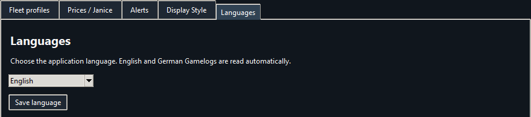

# EVE Mining Monitor

**V2.16 · Windows and macOS Beta**

Track cargo, estimated mining income and reprocessing products across multiple EVE Online pilots. V2.16 reads English and German Gamelogs.

| Platform | Download | Start |
| --- | --- | --- |
| Windows | [V2.16 Windows ZIP](https://github.com/Marci1125/Eve-Mining-Monitor/raw/refs/heads/main/EVE-Mining-V2.16-Python-Share.zip) | Extract the ZIP and run **EVE-Mining.exe**. Python is bundled. |
| macOS (Beta) | [V2.16 macOS ZIP](https://github.com/Marci1125/Eve-Mining-Monitor/raw/refs/heads/main/EVE-Mining-V2.16-macOS-Beta.zip) | Install [Python 3.12 with Tk](https://www.python.org/downloads/macos/), extract the ZIP and open **Start EVE Mining.command**. The first launch installs the audio dependency into a local environment. |

Extract the complete ZIP into a writable folder and keep the included files together. Both packages start with blank fleet profiles and no configured Gamelogs folder.

## Quick setup

1. **Select your Gamelogs folder first.** Open **Options → Fleet profiles**, click **Log folder...** near the bottom, and choose the **Gamelogs** folder that contains EVE's `.txt` session logs. Once selected, the path appears beside the button. The monitor needs this folder to find pilots and track mining.

   

   The Windows path shown is an example. Choose the folder where your EVE client actually writes its logs, which may be under OneDrive or a localized Documents folder.
2. Click **Add pilots from logs**. Double-click each pilot and set their ship class, actual hold capacity, number of lasers and raw unboosted cycle time. Set lasers to **0** for a boost-only ship. A raw cycle of **0** enables automatic learning.
3. Name your profile, choose **ICE** or **ORE**, and click **Save and activate profile**.
4. Confirm each pilot's starting cargo. Click **Reset** if the hold is empty, or right-click the pilot to enter its current cargo. Test cargo and attack sounds under **Options → Alerts**.

## What changed from V2.14 to V2.16

- Added the **macOS Beta** alongside the Windows download.
- Added a German interface and automatic detection of English and German Gamelogs. Choose the interface language in **Options → Languages** and restart the monitor.
- Fixed a boost detection issue that could leave the status on **Boost learning** during steady mining. The monitor keeps the last reliable estimate through short gaps and tolerates isolated irregular intervals.
- Added a per-pilot **Mining drones** checkbox to keep small drone yields out of cycle and boost calculations. Those yields still count toward cargo and session totals.
- Changed ISK/h, session value and the trend to use the **BUY value of reprocessed products** at **90.63%** yield, before fees. The price export now covers all 43 reprocessing products, including moon materials.
- Added mined material icons to **Reprocess** and corrected its **Last Price update** date after a price import.
- Added a dashed grey segment in **Style B** for hold space occupied by compressed ore or ice.

## Choose a fleet view

Open **Options → Display Style** to switch between **Style A — Bars**, **Style B — Gauges** and **Style C — Fleet Strip**. All three show cargo, recent yields, estimated time to full and individual resets. **Expand** shows more details.

**Style A — Bars**

**Style B — Gauges**

**Style C — Fleet Strip**

Green indicates normal mining, yellow marks a critical yield, orange marks the configured cargo alert threshold, and red warns at 95% or when another ice block will not fit. A recent yield briefly appears as **+quantity**. In Style B, hover over a gauge to see the tracked compressed volume.

## Reprocessing and prices

Click **Reprocess** to see the current session's mined materials and estimated products, including material already unloaded. The table accounts for complete batches and leftovers. You can adjust the yield for this estimate. The main income display uses 90.63%.

To refresh prices, go to **Options → Prices / Janice** and click **Export price item list**. Appraise the contents of `Reprocessing-products.txt` in Janice, copy the Item / Amount / Volume / Buy / Sell rows, then use **Paste price set...**. The monitor imports BUY prices. It marks totals as partial when quotes or recipes are missing. **Last Price update** turns red after seven days.

## Cargo, alerts and sessions

- Track ICE or ORE, logged compression, estimated time to full and available mining fleet space. The fleet space total excludes boost-only ships.
- Enable optional cargo auto-reset in **Fleet profiles** if you fully unload after a fleet warp. It looks for a mining yield, a fleet warp and a matching hangar message. For other transfers or jettison, reset or correct cargo manually.
- Choose separate cargo and attack sounds and volumes under **Alerts**. To add your own sound, place an MP3 or WAV in **Sounds**, then click **Refresh sounds**. Set the cargo threshold in **Fleet profiles**.
- A session pauses after five minutes without mining and resumes on the next mining yield. **New session** clears session time and income while keeping current cargo.

## Updating and sharing

Close the old version and copy **EVE-Mining.python-state.json** into the new folder beside the EXE or macOS launcher before opening V2.16. This carries over profiles, prices, cargo, preferences and session data. Copy any custom sounds you added. For migration from the C# edition, copy **EVE-Mining.native-state.json** instead; the app imports it on first launch if there is no Python state file.

Share the original ZIPs to distribute a blank copy. They include checksums, instructions and third-party notices. The monitor reads local EVE logs and uses locally stored prices, sounds, recipes and icons. All screenshots use fictional pilots and simulated mining data.
